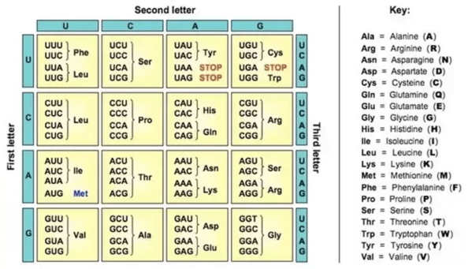

<a id="readme-top"></a>

<!-- PROJECT SHIELDS -->
[![Contributors][contributors-shield]][contributors-url]
[![Forks][forks-shield]][forks-url]
[![Stargazers][stars-shield]][stars-url]
[![Issues][issues-shield]][issues-url]
[![Unlicense License][license-shield]][license-url]
[![LinkedIn][linkedin-shield]][linkedin-url]

<!-- PROJECT LOGO -->
<br />
<div align="center">
  <a href="https://github.com/j0w0j/MuSeq">
    
  </a>

<h3 align="center">MuSeq</h3>

  <p align="center">
    An awesome tool to turn DNA into music!
    <br />
    <a href="https://github.com/j0w0j/MuSeq"><strong>Explore the docs »</strong></a>
    <br />
    <br />
    <a href="https://github.com/j0w0j/MuSeq">View Demo</a>
    &middot;
    <a href="https://github.com/j0w0j/MuSeq/issues/new?labels=bug&template=bug-report---.md">Report Bug</a>
    &middot;
    <a href="https://github.com/j0w0j/MuSeq/issues/new?labels=enhancement&template=feature-request---.md">Request Feature</a>
  </p>
</div>

<!-- TABLE OF CONTENTS -->
<details>
  <summary>Table of Contents</summary>
  <ol>
    <li>
      <a href="#about-the-project">About The Project</a>
      <ul>
        <li><a href="#built-with">Built With</a></li>
      </ul>
    </li>
    <li>
      <a href="#getting-started">Getting Started</a>
      <ul>
        <li><a href="#prerequisites">Prerequisites</a></li>
        <li><a href="#installation">Installation</a></li>
      </ul>
    </li>
    <li><a href="#usage--quick-start">Usage / Quick Start</a></li>
    <li><a href="#composing-with-dna">Composing with DNA</a></li>
      <ul>
        <li><a href="#metadata">Metadata</a></li>
        <li><a href="#notes">Notes</a></li>
        <li><a href="#additional-information">Additional information</a></li>
        <li><a href="#example">Example</a></li>
      </ul>  
   <li><a href="#translation-tables">Translation Tables</a></li>
      <ul>
        <li><a href="#metadata">Metadata</a></li>
        <li><a href="#notes">Notes</a></li>
         <ul>
          <li><a href="#translationtable">Translationtable</a></li>
          <li><a href="#calculations">Calculations</a></li>
         </ul>
      </ul>
</ol>
</details>

## About The Project:
How does a cow sound? You would say "moo" yeahh.. Thats not what we mean, we wanted to know the sound DNA makes!
<br><br>
**MuSeq** is an interactive tool that bridges the gap between bioinformatics and audio/composing skills. 
Instead of looking at endless "boring" lines of genetic sequences, MuSeq translates and lets you translate real 
DNA sequence into playable (maybe) customized music.

### Key Features & Benefits:
- Works with fasta as file format for the input data
- Works both with DNA & RNA
- Output is a MIDI-file which is playable through a wide variety different tools and programs
- Easy to use, even with little to no bioinformatics background

<p align="right">(<a href="#readme-top">back to top</a>)</p>

### Built With:
- [![Java][Java-shield]][Java-url]
- [![Gradle][Gradle-shield]][Gradle-url]

<p align="right">(<a href="#readme-top">back to top</a>)</p>

## Getting Started:

### Prerequisites:
Make sure you have Java installed on your machine:
* Java JDK (26 or higher)

<p align="right">(<a href="#readme-top">back to top</a>)</p>

### Installation:
Follow these steps to install MuSeq:

**1.Clone the repository**
```bash
   git clone [https://github.com/j0w0j/MuSeq.git](https://github.com/j0w0j/MuSeq.git)
```
**2. Go to the project folder**
```bash
cd MuSeq
```
**3. Build project with Gradle**
```bash
gradle build 
```

<p align="right">(<a href="#readme-top">back to top</a>)</p>

## Usage / Quick Start:
You can use the tool with the build gradle compiled JAR file:
```bash
java -jar build/libs/MuSeq-1.0-SNAPSHOT.jar input.fasta --output output.mid
```
<p align="right">(<a href="#readme-top">back to top</a>)</p>

## Composing with DNA

If you want to compose music from DNA using this tool, here is what you should know:

### Metadata

The first 10 codons are used as "metadata" for the music. These are used for options such as BPM and instrument. These codons are NOT used as notes for the music.  
The table below shows which codon(s) are used for which option.

TODO tabel maken, de tabel hieronder is een voorbeeld van wat het zou kunnen zijn.

| Option | Codon Number(s) |
| ------ | ------ |
| BPM | 1 |
| Instrument | 2 and 3 |
| Iets ander leuks | 4 |
| etc.. | 4 and 5 |

For more information about what each codon translates too, see the Translation Tables section. Here you will find a table for each option.

### Notes

All codons after the metadata section are used for notes. Each note consists of 3 codons:

 - The first codon is used for the pitch of the note. For example codon TTT translates to C3.
 - The second codon is used for the length/duration of the note. A duration of 480 is equal to a quarter note. There is not yet rhythm or time signature implemented here.
 - The third codon is used for the volume of the note. 

For more information about what each codon translates too, see the Translation Tables section. 
Here you will find a table for each property of a note. Followed by an explanation of which calculations
were used for the translations.

### Additional information

 - Headers (starting with >) are ignored. 
   - If composing, this can be useful for labeling sections of a song.
 - Gaps and ambiguous nucleotides are ignored. Only nucleotides A, C, G, T and U are recognized.
   - Example: Sequence AAANNNTTT---CCCRRR will be read as AAATTTCCC.
   - For more info, see [this IUPAC nucleotide code table](https://www.bioinformatics.org/sms/iupac.html).
 - Nucleotide U translates the same as T. 
   - For example, TTT and UUU both translate to note C3.

### Example 

hier moet nog text komen verhaal lalallal

<p align="right">(<a href="#readme-top">back to top</a>)</p> 

## Translation Tables

### Metadata

#### BPM

TODO

#### Instruments

| Codons | Instrument number | Instrument |
| ------ | ----------------- | ---------- |
| TTTTTT | 0 | Acoustic Grand Piano |
| TTCTTT | 1 | Bright Acoustic Piano |
| TTATTT | 2 | Electric Grand Piano |
| TTGTTT | 3 | Honky-tonk Piano |
| TCTTTT | 4 | Electric Piano 1 |
| TCCTTT | 5 | Electric Piano 2 |
| TCATTT | 6 | Harpsichord |
| TCGTTT | 7 | Clavinet |
| TATTTT | 8 | Celesta |
| TACTTT | 9 | Glockenspiel |
| TAATTT | 10 | Music Box |
| TAGTTT | 11 | Vibraphone |
| TGTTTT | 12 | Marimba |
| TGCTTT | 13 | Xylophone |
| TGATTT | 14 | Tubular Bells |
| TGGTTT | 15 | Dulcimer |
| CTTTTT | 16 | Drawbar Organ |
| CTCTTT | 17 | Percussive Organ |
| CTATTT | 18 | Rock Organ |
| CTGTTT | 19 | Church Organ |
| CCTTTT | 20 | Reed Organ |
| CCCTTT | 21 | Accordion |
| CCATTT | 22 | Harmonica |
| CCGTTT | 23 | Tango Accordion |
| CATTTT | 24 | Acoustic Guitar (nylon) |
| CACTTT | 25 | Acoustic Guitar (steel) |
| CAATTT | 26 | Electric Guitar (jazz) |
| CAGTTT | 27 | Electric Guitar (clean) |
| CGTTTT | 28 | Electric Guitar (muted) |
| CGCTTT | 29 | Overdriven Guitar |
| CGATTT | 30 | Distortion Guitar |
| CGGTTT | 31 | Guitar Harmonics |
| ATTTTT | 32 | Acoustic Bass |
| ATCTTT | 33 | Electric Bass (finger) |
| ATATTT | 34 | Electric Bass (pick) |
| ATGTTT | 35 | Fretless Bass |
| ACTTTT | 36 | Slap Bass 1 |
| ACCTTT | 37 | Slap Bass 2 |
| ACATTT | 38 | Synth Bass 1 |
| ACGTTT | 39 | Synth Bass 2 |
| AATTTT | 40 | Violin |
| AACTTT | 41 | Viola |
| AAATTT | 42 | Cello |
| AAGTTT | 43 | Contrabass |
| AGTTTT | 44 | Tremolo Strings |
| AGCTTT | 45 | Pizzicato Strings |
| AGATTT | 46 | Orchestral Harp |
| AGGTTT | 47 | Timpani |
| GTTTTT | 48 | String Ensemble 1 |
| GTCTTT | 49 | String Ensemble 2 |
| GTATTT | 50 | Synth Strings 1 |
| GTGTTT | 51 | Synth Strings 2 |
| GCTTTT | 52 | Choir Aahs |
| GCCTTT | 53 | Voice Oohs |
| GCATTT | 54 | Synth Voice |
| GCGTTT | 55 | Orchestra Hit |
| GATTTT | 56 | Trumpet |
| GACTTT | 57 | Trombone |
| GAATTT | 58 | Tuba |
| GAGTTT | 59 | Muted Trumpet |
| GGTTTT | 60 | French Horn |
| GGCTTT | 61 | Brass Section |
| GGATTT | 62 | Synth Brass 1 |
| GGGTTT | 63 | Synth Brass 2 |
| GGATTC | 64 | Soprano Sax |
| GGGTTC | 65 | Alto Sax |
| GGGTTA | 66 | Tenor Sax |
| GGGTTG | 67 | Baritone Sax |
| GGGTCT | 68 | Oboe |
| GGGTCC | 69 | English Horn |
| GGGTCA | 70 | Bassoon |
| GGGTCG | 71 | Clarinet |
| GGGTAT | 72 | Piccolo |
| GGGTAC | 73 | Flute |
| GGGTAA | 74 | Recorder |
| GGGTAG | 75 | Pan Flute |
| GGGTGT | 76 | Blown Bottle |
| GGGTGC | 77 | Shakuhachi |
| GGGTGA | 78 | Whistle |
| GGGTGG | 79 | Ocarina |
| GGGCTT | 80 | Lead 1 (square) |
| GGGCTC | 81 | Lead 2 (sawtooth) |
| GGGCTA | 82 | Lead 3 (calliope) |
| GGGCTG | 83 | Lead 4 (chiff) |
| GGGCCT | 84 | Lead 5 (charang) |
| GGGCCC | 85 | Lead 6 (voice) |
| GGGCCA | 86 | Lead 7 (fifths) |
| GGGCCG | 87 | Lead 8 (bass + lead) |
| GGGCAT | 88 | Pad 1 (new age) |
| GGGCAC | 89 | Pad 2 (warm) |
| GGGCAA | 90 | Pad 3 (polysynth) |
| GGGCAG | 91 | Pad 4 (choir) |
| GGGCGT | 92 | Pad 5 (bowed) |
| GGGCGC | 93 | Pad 6 (metallic) |
| GGGCGA | 94 | Pad 7 (halo) |
| GGGCGG | 95 | Pad 8 (sweep) |
| GGGATT | 96 | FX 1 (rain) |
| GGGATC | 97 | FX 2 (soundtrack) |
| GGGATA | 98 | FX 3 (crystal) |
| GGGATG | 99 | FX 4 (atmosphere) |
| GGGACT | 100 | FX 5 (brightness) |
| GGGACC | 101 | FX 6 (goblins) |
| GGGACA | 102 | FX 7 (echoes) |
| GGGACG | 103 | FX 8 (sci-fi) |
| GGGAAT | 104 | Sitar |
| GGGAAC | 105 | Banjo |
| GGGAAA | 106 | Shamisen |
| GGGAAG | 107 | Koto |
| GGGAGT | 108 | Kalimba |
| GGGAGC | 109 | Bagpipe |
| GGGAGA | 110 | Fiddle |
| GGGAGG | 111 | Shanai |
| GGGGTT | 112 | Tinkle Bell |
| GGGGTC | 113 | Agogo |
| GGGGTA | 114 | Steel Drums |
| GGGGTG | 115 | Woodblock |
| GGGGCT | 116 | Taiko Drum |
| GGGGCC | 117 | Melodic Tom |
| GGGGCA | 118 | Synth Drum |
| GGGGCG | 119 | Reverse Cymbal |
| GGGGAT | 120 | Guitar Fret Noise |
| GGGGAC | 121 | Breath Noise |
| GGGGAA | 122 | Seashore |
| GGGGAG | 123 | Bird Tweet |
| GGGGGT | 124 | Telephone Ring |
| GGGGGC | 125 | Helicopter |
| GGGGGA | 126 | Applause |
| GGGGGG | 127 | Gunshot |

The instrument names listed above are retrieved from: https://songen.app/tools/general-midi-instruments/

<p align="right">(<a href="#readme-top">back to top</a>)</p>

### Notes
The notes are composed using 3 consecutive codons. Each possible codon is assigned a number, 
which is translated into either the pitch, volume or length of the note, always in that order meaning the first
of the consecutive codons is always used for pitch etc.

#### Translationtable
Depending on whether the data contains DNA or RNA nucleotides all T's 
can be exchanged for U's. Beneath the table will be an explanation of each calculation
used to create the different note characteristics per codon.

| Codon | Number | Note pitch | Note length | Note volume |
|-------|:-------|------------|-------------|:------------|
| TTT   | 0      | C3         | 0           | 0           |
| TTC   | 1      | C#3        | 30          | 2           |
| TTA   | 2      | D3         | 60          | 4           |
| TTG   | 3      | D#3        | 120         | 6           |
| TCT   | 4      | E3         | 150         | 8           |
| TCC   | 5      | F3         | 180         | 10          |
| TCA   | 6      | F#3        | 210         | 12          |
| TCG   | 7      | G3         | 240         | 14          |
| TAT   | 8      | G#3        | 270         | 16          |
| TAC   | 9      | A3         | 300         | 18          |
| TAA   | 10     | A#3        | 330         | 20          |
| TAG   | 11     | B3         | 360         | 22          |
| TGT   | 12     | C4         | 390         | 24          |
| TGC   | 13     | C#4        | 420         | 26          |
| TGA   | 14     | D4         | 450         | 28          |
| TGG   | 15     | D#4        | 480         | 30          |
| CTT   | 16     | E4         | 510         | 32          |
| CTC   | 17     | F4         | 540         | 34          |
| CTA   | 18     | F#4        | 570         | 36          |
| CTG   | 19     | G4         | 600         | 38          |
| CCT   | 20     | G#4        | 630         | 40          |
| CCC   | 21     | A4         | 660         | 42          |
| CCA   | 22     | A#4        | 690         | 44          |
| CCG   | 23     | B4         | 720         | 46          |
| CAT   | 24     | C5         | 750         | 48          |
| CAC   | 25     | C#5        | 780         | 50          |
| CAA   | 26     | D5         | 810         | 52          |
| CAG   | 27     | D#5        | 840         | 54          |
| CGT   | 28     | E5         | 870         | 56          |
| CGC   | 29     | F5         | 900         | 58          |
| CGA   | 30     | F#5        | 930         | 60          |
| CGG   | 31     | G5         | 960         | 62          |
| ATT   | 32     | G#5        | 990         | 64          |
| ATC   | 33     | A5         | 1020        | 66          |
| ATA   | 34     | A#5        | 1050        | 68          |
| ATG   | 35     | B5         | 1080        | 70          |
| ACT   | 36     | C6         | 1110        | 72          |
| ACC   | 37     | C#6        | 1140        | 74          |
| ACA   | 38     | D6         | 1170        | 76          |
| ACG   | 39     | D#6        | 1200        | 78          |
| AAT   | 40     | E6         | 1230        | 80          |
| AAC   | 41     | F6         | 1260        | 82          |
| AAA   | 42     | F#6        | 1290        | 84          |
| AAG   | 43     | G6         | 1320        | 86          |
| AGT   | 44     | G#6        | 1350        | 88          |
| AGC   | 45     | A6         | 1380        | 90          |
| AGA   | 46     | A#6        | 1410        | 92          |
| AGG   | 47     | B6         | 1440        | 94          |
| GTT   | 48     | C7         | 1470        | 96          |
| GTC   | 49     | C#7        | 1500        | 98          |
| GTA   | 50     | D7         | 1530        | 100         |
| GTG   | 51     | D#7        | 1560        | 102         |
| GCT   | 52     | E7         | 1590        | 104         |
| GCC   | 53     | F7         | 1620        | 106         |
| GCA   | 54     | F#7        | 1650        | 108         |
| GCG   | 55     | G7         | 1680        | 110         |
| GAT   | 56     | G#7        | 1710        | 112         |
| GAC   | 57     | A7         | 1740        | 114         |
| GAA   | 58     | A#7        | 1770        | 116         |
| GAG   | 59     | B7         | 1800        | 118         |
| GGT   | 60     | C8         | 1830        | 120         |
| GGC   | 61     | C#8        | 1860        | 122         |
| GGA   | 62     | D8         | 1890        | 124         |
| GGG   | 63     | D#8        | 1920        | 126         |

#### Calculations
Firstly to assign a number to each codon, each letter was assigned a number 0-3. 
The first letter in the codon was multiplied by a factor of 16, the second by a factor of
4 and the last by a factor of 1. Making this work similarly to a 
nucleotide-to-aminoacid-translation-table like shown here below:
<div align="center">
  <a href="https://noorsiddiqui.com/what-is-chip-seq-atac-seq/">
    
  </a>

This results in each codon having a number between 0 and 63. This number is then used to calculate the other 3 numbers 
used in a MIDI-file to describe either the pitch, volume (also referred to as velocity) and note length. 64 options
seemed plenty to us to have as pitch options. We only add 36 to each number to raise the overall pitch 3 full octaves 
as MIDI has 128 pitch options, and we wanted to use the middle of those, surrounding middle C.

Volume also runs from 0-127 and seeing we have exactly half the options, we elected to use a factor 2 for this. 
This way the full scale is available and used. And a step of 2 is definitely small enough to feel gradual in human
perception.

Lastly note length is a number between 0 and 1920. The number is multiplied by 30. This makes each note a length of a 
whole note as the longest option or a sixty-forth note (hemidemisemiquaver) as the shortest. The randomness introduced by
the input results in differing lengths of notes whom are not interconnected, this results in an absence of pulse or
feeling of rhythm. We have not been able to introduce time signatures into this as to help with this.


<p align="right">(<a href="#readme-top">back to top</a>)</p>


<!-- MARKDOWN LINKS & IMAGES -->
[contributors-shield]: https://img.shields.io/github/contributors/j0w0j/MuSeq.svg?style=for-the-badge
[contributors-url]: https://github.com/j0w0j/MuSeq/graphs/contributors
[forks-shield]: https://img.shields.io/github/forks/j0w0j/MuSeq.svg?style=for-the-badge
[forks-url]: https://github.com/j0w0j/MuSeq/network/members
[stars-shield]: https://img.shields.io/github/stars/j0w0j/MuSeq.svg?style=for-the-badge
[stars-url]: https://github.com/j0w0j/MuSeq/stargazers
[issues-shield]: https://img.shields.io/github/issues/j0w0j/MuSeq.svg?style=for-the-badge
[issues-url]: https://github.com/j0w0j/MuSeq/issues
[license-shield]: https://img.shields.io/github/license/j0w0j/MuSeq.svg?style=for-the-badge
[license-url]: https://github.com/j0w0j/MuSeq/blob/master/LICENSE.txt
[linkedin-shield]: https://img.shields.io/badge/-LinkedIn-black.svg?style=for-the-badge&logo=linkedin&colorB=555
[linkedin-url]: https://linkedin.com/in/jouw_linkedin_gebruikersnaam
[product-screenshot]: README_img/screenshot.png
[Java-shield]: https://img.shields.io/badge/Java-ED8B00?style=for-the-badge&logo=openjdk&logoColor=white
[Java-url]: https://www.oracle.com/java/
[Gradle-shield]: https://img.shields.io/badge/Gradle-02303A?style=for-the-badge&logo=gradle&logoColor=white
[Gradle-url]: https://gradle.org/